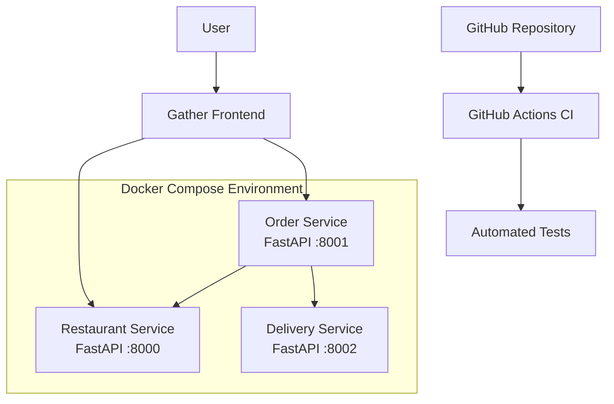

# Gather — DevOps-Based Food Delivery Application with Microservices Architecture

Gather is a food delivery web application developed using a microservices architecture. It demonstrates how independent backend services communicate to support restaurant browsing, order placement, and delivery tracking.

The project focuses on containerization, automated testing, service health monitoring, and continuous integration using free development tools.

## Features

- **Restaurant Service:** Provides restaurant information and validates restaurant availability.
- **Order Service:** Creates and retrieves customer orders.
- **Delivery Service:** Creates delivery records and simulates delivery status updates.
- **Order Tracking:** Displays order details and delivery progress through the frontend.
- **Microservices Architecture:** Separates restaurant, order, and delivery functionality into independent services.
- **Docker Compose:** Builds and runs backend services as containers.
- **Health Checks:** Automatically checks whether each backend service is responding.
- **Automated Testing:** Uses pytest to run backend tests.
- **Continuous Integration:** Uses GitHub Actions to run automated tests on code pushes.
- **Modern Frontend:** Provides restaurant browsing, a shopping cart, order placement, and order tracking.
- **Light and Dark Themes:** Offers theme switching in the frontend.

## Technology Stack

| Component | Technology |
|---|---|
| Frontend | HTML, CSS, JavaScript |
| Backend | Python, FastAPI |
| HTTP Communication | HTTPX |
| Containerization | Docker |
| Multi-container Management | Docker Compose |
| Testing | Pytest |
| CI Pipeline | GitHub Actions |
| Version Control | Git and GitHub |

## System Architecture



### How the application works

1. The user opens the Gather frontend.
2. The frontend displays restaurant and food options.
3. When an order is placed, the Order Service checks restaurant availability.
4. The Order Service creates the order and requests a delivery record from the Delivery Service.
5. The Delivery Service simulates delivery progress.
6. The frontend retrieves order information and displays delivery status.
7. Docker Compose runs the backend containers and checks their health.
8. GitHub Actions runs the automated test workflow when code is pushed to GitHub.

## Project Structure

```text
food-delivery-microservices/
├── api-gateway/
├── delivery-service/
│   └── main.py
├── docs/
├── frontend/
│   ├── index.html
│   ├── style.css
│   └── app.js
├── order-service/
│   └── main.py
├── restaurant-service/
│   └── main.py
├── tests/
│   ├── test_order.py
│   └── test_restaurant.py
├── .github/
│   └── workflows/
│       └── tests.yml
├── docker-compose.yml
└── README.md
```

*Note: This shows the main project structure. Additional files, such as Dockerfiles and dependency files, may exist inside the service directories.*

## Prerequisites

Install the following tools before running the project:

- Python
- Git
- Docker Desktop
- Docker Compose

Docker Desktop must be running when you start the containerized backend services.

## Getting Started

### 1. Clone the repository

```bash
git clone https://github.com/anusha2104/food-deliver-microservices.git
cd food-delivery-microservices
```

### 2. Start the backend services

Make sure Docker Desktop is running, then execute:

```bash
docker compose up -d --build
```

This builds the service images if necessary and starts the backend containers.

### 3. Check the service status

```bash
docker compose ps
```

Wait until all three services show `healthy` in the status column.

### 4. Start the frontend

Open a new terminal in the project root and run:

```bash
python -m http.server 5500 --directory frontend
```

Open the application in your browser:

**http://127.0.0.1:5500/**

Keep this terminal open while using the frontend.

### 5. Stop the application

To stop the backend containers when you finish working:

```bash
docker compose down
```

This stops and removes the Compose containers and network. It does not delete your source code.

Stop the frontend server separately by pressing `Ctrl + C` in its terminal.

## Service Endpoints

| Service | Port | Endpoint | Purpose |
|---|---:|---|---|
| Restaurant | 8000 | `/restaurants` | Retrieve restaurants |
| Restaurant | 8000 | `/health` | Check service health |
| Order | 8001 | `/orders` | Retrieve orders |
| Order | 8001 | `/orders` (POST) | Create an order |
| Order | 8001 | `/health` | Check service health |
| Delivery | 8002 | `/deliveries` | Retrieve deliveries |
| Delivery | 8002 | `/deliveries` (POST) | Create a delivery |
| Delivery | 8002 | `/health` | Check service health |

Interactive API documentation is available through FastAPI:

- Restaurant Service: http://127.0.0.1:8000/docs
- Order Service: http://127.0.0.1:8001/docs
- Delivery Service: http://127.0.0.1:8002/docs

## Health Monitoring

Each backend service exposes a `/health` endpoint that returns its service name and health status.

Docker Compose is configured with health checks that periodically request these endpoints. A successful response allows Docker to mark the corresponding container as `healthy`.

This helps identify services that are running but not responding correctly to health checks.

## Automated Testing

The project uses pytest for automated backend tests.

To run the tests locally, activate the project's virtual environment if needed and execute:

```bash
python -m pytest -v
```

The tests cover selected restaurant and order service functionality.

## Continuous Integration with GitHub Actions

The project includes a GitHub Actions workflow located at:

`.github/workflows/tests.yml`

The workflow automatically runs the configured test process when changes are pushed to GitHub.

This helps identify test failures early and provides feedback on code changes.

**Latest verified result during development:** The local test suite reported four passing tests, and the GitHub Actions workflow completed successfully for commit `cc62e8c`.

## Delivery Simulation

The Delivery Service simulates delivery progress using timed status changes:

1. Preparing
2. Out for Delivery
3. Delivered

The demonstration advances delivery status at approximately 20-second intervals.

**Important:** This is a simulated delivery workflow. The project does not implement real-time driver GPS tracking.

## Current Limitations

- Orders and deliveries are stored in application memory rather than a persistent database.
- Restarting the relevant service can clear its in-memory data.
- Delivery progress is simulated rather than connected to a real delivery partner.
- The project is intended as an academic demonstration of microservices and DevOps concepts.

## Future Enhancements

- Integrate a persistent database for orders and deliveries.
- Add authentication and user accounts.
- Introduce API gateway routing and centralized configuration.
- Add structured logging and metrics dashboards.
- Improve automated integration testing.
- Explore automated deployment to a cloud environment.

## Author

**Anusha Mittal**

B.Tech — Computer Science and Engineering

Manipal University Jaipur

GitHub: [anusha2104](https://github.com/anusha2104)

---

*Built as a Cloud Automation and Tools project to demonstrate microservices architecture, containerization, automated testing, and continuous integration.*